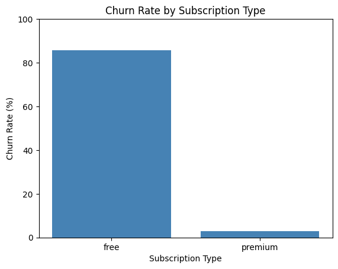
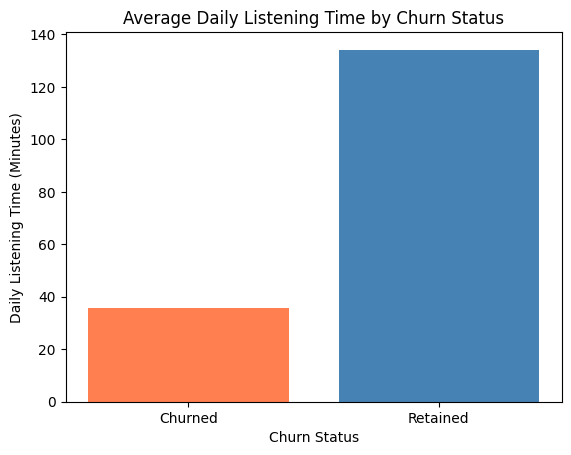

# Customer Churn & Engagement Analysis

## Business Problem

A music streaming platform needs to understand which customer segments have higher churn rates and how user engagement differs between churned and retained customers.

This project aims to identify churn patterns and provide recommendations to support customer retention.

## Dataset

The dataset was provided as part of a data analytics bootcamp and contains 70 user records, including demographic information, subscription type, device, music genre preferences, daily listening time, skip rate, ad-click activity, and churn status.

## Tools & Methodology

- **Excel:** Data preparation and documentation.
- **SQL:** Data validation, customer segmentation, churn rate calculations, and engagement analysis.
- **Python (Pandas & Matplotlib):** Customer segment analysis and data visualization.

## Key Findings

### Customer Churn

- The overall churn rate was 44.29%, with 31 out of 70 users leaving the platform.
- Free users had a much higher churn rate than premium users (85.71% vs. 2.86%).
- Users aged 19–29 had the highest churn rate among the age groups (82.35%).
- Free users aged 19–29 had a churn rate of 87.50%, accounting for 28 of the 31 churned users.
- Mobile users had a higher churn rate than desktop users (55.81% vs. 25.93%).

### Customer Engagement

- Churned users spent approximately 73.5% less time listening to music than retained users (35.55 vs. 134.15 minutes per day).
- Churned users had a higher average skip rate than retained users (53.4% vs. 13.6%).
- Users who clicked on ads had a higher churn rate than those who did not (85.71% vs. 2.86%).

## Business Recommendations

- Prioritize free users aged 19–29 in retention initiatives.
- Monitor daily listening time and skip rate as potential indicators of customer disengagement.
- Test personalized music recommendations and targeted engagement campaigns.
- Further investigate the relationship between ad-click activity and customer churn before making changes to the advertising strategy.

## Conclusion

The analysis identifies priority customer segments and engagement patterns associated with churn. These findings can help the platform focus its retention efforts on specific customer groups and develop more targeted engagement strategies.

## Limitations

- The analysis is based on an educational dataset of 70 users.
- Two missing skip rate values were excluded from the relevant average calculations.
- The findings reflect associations rather than causal relationships.

- ## Visualizations

 
